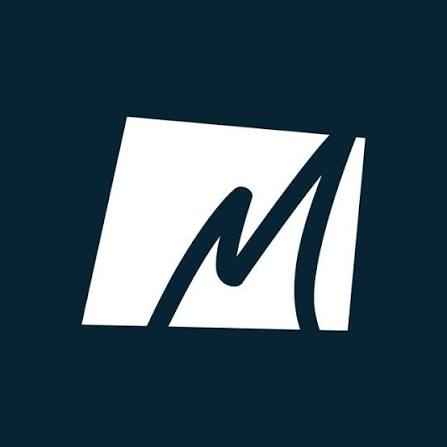

<div align="center">
  
  <h1>Mitru Express — Sistema de Control</h1>
  <p>Sistema web para la gestión eficiente de inventario, proveedores y productos.</p>

  <a href="https://almacenes-mitru-express.vercel.app/index.html">
    
  </a>
  
  
  
</div>

<br>

## 🚀 Demo en Vivo

Puedes probar el sistema funcionando en tiempo real (con soporte para captura de fotos por cámara) en el siguiente enlace:

👉 **[almacenes-mitru-express.vercel.app](https://almacenes-mitru-express.vercel.app/index.html)**

---

## 📋 Características Principales

* **Dashboard Interactivo:** Resumen general del sistema con indicadores visuales.
* **Gestión de Inventario:** Control de stock, estados de productos y alertas de bajo inventario.
* **Gestión de Proveedores:** Registro detallado de proveedores, días de entrega y pedidos.
* **Cámara Integrada:** Posibilidad de tomar fotos o subir imágenes directamente desde la interfaz para los productos o proveedores.
* **Interfaz Moderna:** Diseño responsivo, animaciones fluidas y una pantalla de carga (Preloader) que mejora la experiencia de usuario.
* **Tablas Dinámicas:** Uso de DataTables para búsqueda, filtrado y paginación de registros.

---

## 🛠️ Tecnologías Utilizadas

Este proyecto fue construido utilizando tecnologías web estándar, sin frameworks pesados, priorizando el rendimiento y la limpieza del código:

* **HTML5 / CSS3** (Variables CSS, Flexbox, Grid, Animaciones)
* **JavaScript (Vanilla ES6+)** 
* [Font Awesome](https://fontawesome.com/) (Iconografía)
* [DataTables](https://datatables.net/) (Manejo de tablas)
* [Google Fonts](https://fonts.google.com/) (Tipografía Inter)

---

## 📂 Estructura del Proyecto

```text
mitru/
├── assets/
│   ├── css/          # Estilos (estilos-sistema, estilo-main, modales)
│   ├── img/          # Imágenes y logos
│   └── js/           # Lógica (layout, sidebar, modales, tablas)
├── pages/
│   ├── components/   # Sidebar y Navbar (inyectados dinámicamente)
│   ├── dashboard.html
│   ├── inventario.html
│   ├── proveedores.html
│   └── login.html
└── index.html        # Página de entrada

💻 Instalación y Uso Local
Si deseas clonar y ejecutar este proyecto en tu computadora, sigue estos pasos:

Clona el repositorio:

bash
git clone https://github.com/RocelGerl/mitru.git
Abre la carpeta del proyecto en Visual Studio Code.

Instala la extensión Live Server (de Ritwick Dey).

Haz clic derecho sobre el archivo index.html (o pages/dashboard.html) y selecciona "Open with Live Server".

⚠️ Nota importante: El módulo de la cámara (getUserMedia) requiere que la página se ejecute en un entorno seguro. Funciona en localhost o en conexiones HTTPS (como el enlace de Vercel). No funcionará si abres el archivo directamente con doble clic (file://).

👨‍💻 Autor
Desarrollado para Mitru Express.

GitHub: @RocelGerl

Si te gusta el proyecto, ¡no olvides dejar una ⭐ en el repositorio!
